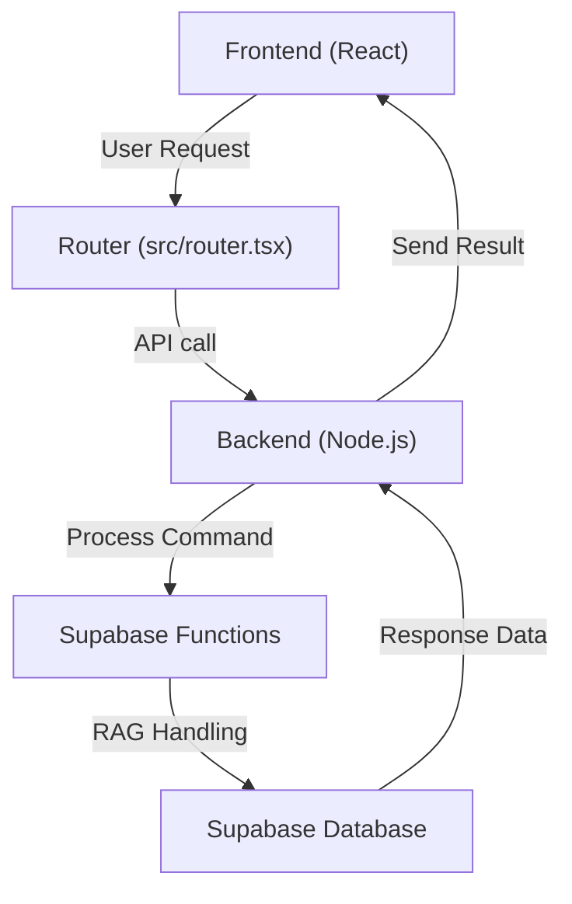

# rag-builder

A TypeScript-powered interface and backend for managing and processing Retrieval-Augmented Generation (RAG) tasks.

 

<!-- Screenshot: add docs/screenshot.png -->

## Overview

The **rag-builder** system provides a unified platform to manage RAG workflows. It integrates an admin dashboard, dynamic table management, Supabase as its backend, and input handling features for enhanced processing capabilities. While providing flexibility for integrations, the system supports key operations like exporting, importing, and data processing.

## Features

- **Dynamic table management**: Create, rename, and delete tables dynamically with handlers like `server/src/handlers/n8n-create-table.ts` and `server/src/handlers/n8n-rename-table.ts`.
- **Admin dashboard**: Includes UI components for controlling important operations, e.g., `src/components/qa-dashboard/ExcelImportBox.tsx`.
- **File handling for QA**: Process Excel files using libraries like `exceljs` to streamline imports (`src/components/qa-dashboard/ExcelImportBox.tsx`).
- **Supabase integration**: Backend relies on Supabase with dedicated functions in `supabase/functions/` for operations like table creation and RAG data management.
- **Rich UI toolkit**: Implements modern UI with Radix components for features like accordions, tabs, and notifications (`src/components/ui`).
- **TypeScript-first design**: Ensures type safety across components, functions, and APIs. 
- **Custom hooks**: Abstracts repeated logic, e.g., `src/hooks/use-mobile.tsx` and `src/hooks/use-theme.ts`.

## How It Works



## Tech Stack

- **Frontend**: React, Radix UI, TailwindCSS
- **Backend**: Node.js, Supabase
- **Languages/tools**: TypeScript, Vite, ESLint, Prettier
- **Libraries**: React Hook Form, Zod, ExcelJS, Recharts

## Getting Started

### Prerequisites

- Node.js and npm installed
- Supabase backend environment configured
- `.env` file set up as per `server/.env.example`

### Steps

1. Clone the repository:
   ```bash
   git clone https://github.com/EF361/tuah-rag-a565f215.git
   cd tuah-rag-a565f215
   ```

2. Install dependencies:
   ```bash
   npm install
   ```

3. Start the development server:
   ```bash
   npm run dev
   ```

4. Access the application on `http://localhost:5173`.

## Project Structure

```
.
├── docs/
│   ├── architecture.md
│   ├── deployment.md
│   ├── environment.md
│   └── usage.md
├── server/
│   ├── src/
│   │   ├── handlers/
│   │   │   ├── n8n-create-table.ts
│   │   │   ├── n8n-rename-table.ts
│   │   │   └── n8n-delete.ts
│   │   ├── lib/
│   │   │   └── n8n-jwt.ts
│   │   └── index.ts
│   ├── package.json
│   └── tsconfig.json
├── src/
│   ├── components/
│   │   ├── qa-dashboard/
│   │   │   ├── ExcelImportBox.tsx
│   │   │   └── QATable.tsx
│   │   └── ui/
│   │       ├── accordion.tsx
│   │       └── button.tsx
│   ├── integrations/
│   │   └── supabase/
│   │       └── client.ts
│   ├── hooks/
│   │   └── use-mobile.tsx
│   ├── lib/
│   │   └── rag-schema.ts
│   ├── main.tsx
│   └── router.tsx
├── supabase/
│   ├── functions/
│   │   ├── n8n-create-table/
│   │   └── n8n-rename-table/
│   └── config.toml
├── package.json
└── vite.config.ts
```

## Roadmap

- [ ] Compare repository identity or consolidate duplicates.
- [ ] Harden webhook authentication mechanisms.
- [ ] Add idempotency tests for bulk operations and dynamic table management.
- [ ] Document release provenance to link domains to commit history.

---

Built by [Alicia Goh](https://github.com/EF361)